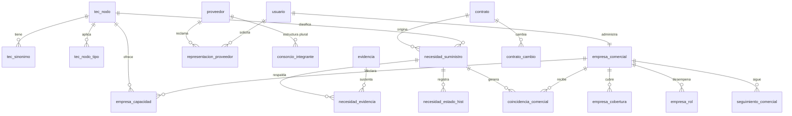

# Commercial & Supply Intelligence — Arquitectura y datos (entregables 3–10, 13, 20)

Fecha: 2026-11-09 · Estado: **propuesta; ninguna tabla existe**. Según CONDUCTA §4
y `docs/sdd/00-esqueleto.md`, toda tabla se añade **primero** al esqueleto del SDD
y requiere plan aprobado; este documento es el insumo, no la fuente de verdad.
Todas las tablas nuevas nacen con `.enableRLS()`. No se aplica ninguna migración.

## 1. Arquitectura funcional

Monolito Next.js actual; sin microservicios (no hay necesidad demostrada).
Dominios como carpetas bajo `src/lib/` (patrón del repo), no como paquetes:

| Dominio del brief | Carpeta | Contenido |
|---|---|---|
| technology-classification | `src/lib/tecnologia/` | taxonomía versionada, sinónimos, clasificador puro |
| business-profiles | `src/lib/empresa/` | perfil internacional, estados de dato, verificación |
| supplier-intelligence | `src/lib/suministro/` | necesidades, evidencia, máquina de estados |
| commercial-matching | `src/lib/matching-comercial/` | afinidad, evidencia, explicación |
| commercial-intelligence | `src/lib/comercial/` | ficha comercial, seguimiento, fachada para la Ficha |
| market-analytics | `src/lib/mercado/` | agregados (reusa `agregados.ts`, `informe.ts`) |

Flujo: SECOP/Socrata → ingesta existente → `proceso`/`contrato`/`proveedor` →
**clasificador tecnológico (reglas, puro)** → candidatos de necesidad + evidencia
→ matching con `empresa_comercial` → ficha / alerta. Trabajo incremental: un job
sobre contratos con `updated_at` posterior a la última versión del clasificador
(mismo patrón que `db:tipo-proyecto`), idempotente por `(contrato_id, nodo_id, version)`.
Cron nuevo solo si el límite de crons de Vercel lo permite (SDD V-F-5).

## 2. Modelo de datos propuesto

Convenciones del repo: PK uuid, `text` en lugar de enum de Postgres, jsonb para
atributos no consultados, ids nativos de SECOP como texto cuando se referencian
desde cuentas.



### Tablas (nombres de trabajo)

| Tabla | Claves e índices clave | Notas |
|---|---|---|
| `tec_nodo` | PK id; UNIQUE (`codigo`,`version`); idx `padre_id` | Jerarquía versionada; `activo`; `nombre_es`, `nombre_en` |
| `tec_sinonimo` | UNIQUE (`nodo_id`,`termino_norm`,`idioma`) | `tipo`: sinónimo/abreviatura/marca/negativo |
| `tec_nodo_tipo` | PK (`nodo_id`,`tipo_proyecto`) | Un nodo, varios tipos; `tipo_proyecto` validado contra `TIPOS_PROYECTO` en código |
| `empresa_comercial` | UNIQUE `usuario_id` (V1); idx `pais` | `razon_social`, `pais`, `registro`, `sitio`, `estado_verificacion`, `atributos jsonb` (cada campo `{valor, estado}`) |
| `empresa_rol` | PK (`empresa_id`,`rol`) | Roles del brief §4; varios por empresa; `origen`: declarado/documentado/verificado |
| `empresa_capacidad` | UNIQUE (`empresa_id`,`nodo_id`); idx `nodo_id` | `estado_dato`, `marcas text[]`, `especificaciones jsonb` sin precios |
| `empresa_cobertura` | PK (`empresa_id`,`divipola`) | Departamento (2 díg.) o municipio (5 díg.) |
| `representacion_proveedor` | UNIQUE parcial (`proveedor_id`) WHERE estado='verificada'; idx `usuario_id` | Estados: solicitada/verificada/rechazada/revocada; **compartida con TI (D10)**; solo `proveedor.tipo_documento='NIT'` (CHECK vía trigger o validación de servidor) |
| `consorcio_integrante` | UNIQUE (`estructura_id`,`integrante_nit`) | **Solo si hay fuente (D3)**; `fuente`: oficial/declarado; `evidencia_id`; sin personas naturales |
| `contrato_cambio` | idx (`contrato_id`,`detectado_en`) | Línea base acotada de `valor_actual`/`fecha_fin_actual`/`estado_actual` (reemplaza la ausencia de `contrato_evento`); últimos N por contrato |
| `evidencia` | idx (`entidad_tipo`,`entidad_id`); UNIQUE (`hash_texto`,`localizador`) | Ver §4; sin datos personales |
| `necesidad_suministro` | UNIQUE (`contrato_id`,`nodo_id`,`version_clasificador`); idx (`estado`), (`nodo_id`,`estado`) | `cantidad`, `especificaciones`, `fecha_entrega` **nullable**; `titulo_fuente` es el texto citado |
| `necesidad_evidencia` | PK (`necesidad_id`,`evidencia_id`) | |
| `necesidad_estado_hist` | append-only; idx `necesidad_id` | `de`, `a`, `actor_tipo` (sistema/contratista_verificado/admin), `actor_id`, `motivo` |
| `coincidencia_comercial` | UNIQUE (`empresa_id`,`necesidad_id`,`version_algoritmo`); idx (`empresa_id`,`creado_en`) | `afinidad` numérico, `calidad_evidencia` A–D, `explicacion jsonb` |
| `seguimiento_comercial` | UNIQUE (`usuario_id`,`objeto_tipo`,`objeto_id`) | Guardar/seguir; reemplaza prefijos en `senal_usuario` para este dominio |
| `auditoria_accion` | idx (`actor_id`,`creado_en`) | Quién, qué, cuándo; sin payload sensible |
| `consentimiento_comercial` | UNIQUE (`usuario_id`,`finalidad`) | Alertas comerciales; independiente de marketing y alertas de licitación |

**Aislamiento:** las filas de `empresa_*`, `seguimiento_*`, `coincidencia_comercial`
se filtran por `usuario_id` en cada consulta (R8 y CLAUDE.md §4); RLS sin políticas
cierra la Data API. Las tablas de datos públicos (`tec_*`, `necesidad_*`,
`evidencia`) se leen en servidor y se exponen vía DTO; `necesidad_estado_hist.actor_id`
no sale al cliente.

**Invariante crítica:** transición a `confirmada` o `abierta` solo con
`actor_tipo='contratista_verificado'` y una `representacion_proveedor` verificada
del contrato; se impone en el servicio **y** con CHECK/trigger. Ningún camino de
código de IA puede producirla (test de arquitectura).

## 3. Taxonomía tecnológica (entregable 7)

Segunda clasificación, independiente de `tipo_proyecto`. 18 categorías raíz del
brief (bombeo; válvulas y accesorios; tuberías y redes; filtración; membranas;
tratamiento químico; biológico; instrumentación; automatización industrial; PLC y
SCADA; telemetría e IoT; electromecánicos; ingeniería y diseño; construcción y
montaje; O&M; consultoría; software y gemelos digitales; logística e importación)
con hijos (ej. Bombeo → centrífuga, sumergible, dosificadora). Reglas:
versionada (`v1` congelada, cambios = `v2`, como el cuestionario del
diagnóstico); sinónimos ES/EN y términos **negativos** («sin bombeo», «no incluye
suministro»); un nodo ↔ varios tipos de proyecto; el clasificador es puro y no
escribe. Contenido de v1 = tarea CI-01, revisado por consultor sectorial.

## 4. Modelo de evidencias (entregable 9)

`evidencia.tipo_fuente`: `secop_campo` (columna de `proceso`/`contrato`),
`pliego_usuario` (texto de pliego subido), `documento_oficial` (cuando exista
acceso, hoy 0), `declaracion_empresa`, `inferencia_aquaLicita`.
Campos: cita literal (≤ 40 palabras), localizador (`campo` | `pagina`/`offset`),
hash del texto fuente, `verificada` (la cita se encontró literalmente tras
normalizar espacios), `extraido_en`, `version_extractor`, `vigente_hasta`.
Reglas: sin cita verificada no hay `Documentada`; contradicción entre fuentes ⇒
`needs_review` y se muestran ambas; sin nombres ni documentos de personas;
`EvidenceRef` (TS) es el tipo común con TI, las tablas son por dominio.
Calidad A–D: A = pliego/documento con cita verificada; B = campo SECOP
específico (contrato, valor, fecha); C = texto libre corto con coincidencia de
taxonomía; D = solo inferencia por tipo de proyecto.

## 5. Estados de necesidad (entregable 10)

```
inferida ──▶ documentada ──▶ confirmada ──▶ abierta ──▶ cubierta ──▶ cerrada
   │             │               │            │
   └────────▶ descartada ◀───────┴────────────┘
 (cualquier no terminal) ──▶ suspendida ──▶ (vuelve al estado previo si el contrato se reactiva)
```

| Transición | Quién | Condición |
|---|---|---|
| → inferida | sistema | clasificador con cita de `secop_campo` |
| inferida → documentada | sistema | ítem de pliego con cita verificada |
| documentada/inferida → confirmada | **representante verificado** | solo él |
| confirmada → abierta | representante verificado | define especificaciones y fechas |
| → descartada | representante o admin | motivo obligatorio |
| → suspendida | sistema | contrato terminado/liquidado/cambio de estado, `fecha_fin_actual` vencida, o evidencia retirada |
| abierta → cubierta/cerrada | representante o sistema por vencimiento | |

`Estado de demanda` es independiente del estado SECOP (misma distinción que TI).

## 6. Algoritmo de matching (entregable 8)

Determinista, sin IA, versionado (`version_algoritmo`), explicable; el score
**no** es probabilidad de venta ni de adjudicación.

1. **Compuertas duras** (excluyen y se explican): tipo de actividad incompatible
   (p. ej. solo servicios vs. suministro), cobertura territorial sin alcance,
   necesidad en `descartada/cerrada/suspendida`, contrato no vigente.
2. **Afinidad técnica 0–100:** coincidencia de nodo (exacta 60, hijo/padre 40,
   hermano 20) + especificaciones compatibles (hasta 20, solo si ambas existen) +
   tipo de proyecto compatible vía `tec_nodo_tipo` (10) + marca/capacidad
   documentada (10). Pesos iniciales: **hipótesis a calibrar en el piloto**.
3. **Calidad de evidencia A–D** (§4), independiente del score.
4. **Demanda** = estado de la necesidad, mostrado como etiqueta, no sumado.
5. **Penalizaciones visibles**, no ocultas: soporte posventa no declarado,
   documentación ausente, condiciones comerciales desconocidas (se listan en
   «Qué falta confirmar», no restan silenciosamente).

Salida: `{que_coincide, por_que, evidencias[], falta_confirmar[], restricciones[],
pasos[]}`. Tests obligatorios (CONDUCTA §5): falsos positivos (término genérico
«bomba» en «bomberos»), **negaciones** («no incluye suministro de equipos»),
documentos incompletos, contratos cerrados/suspendidos, empresas con
capacidad solo declarada, determinismo entre corridas.

## 7. Servicios y endpoints (entregable 6)

Todos: validación de entrada, `private, no-store` si hay datos de cuenta, capacidad
declarada en `acceso/politica.ts` (nuevas: `empresa_perfil`, `comercial_coincidencias`,
`comercial_seguimiento`, `contratista_reclamar`; nivel inicial `gratis` hasta D8).

| Método y ruta | Acceso | Descripción |
|---|---|---|
| `GET/PUT /api/comercial/empresa` | dueño | Perfil con estados por dato |
| `GET /api/comercial/taxonomia?v=` | anónimo (cache CDN) | Árbol y sinónimos |
| `GET /api/comercial/contratos/[id]/necesidades` | gratis | Necesidades con evidencia |
| `GET /api/comercial/coincidencias` | gratis | Paginadas, con explicación |
| `POST/DELETE /api/comercial/seguimiento` | gratis | Guardar/seguir |
| `POST /api/comercial/contratista/reclamar` | gratis | Solicita representación |
| `POST /api/comercial/necesidades/[id]/estado` | representante verificado | Confirmar, abrir, descartar |
| `GET /api/comercial/mercado/*` | gratis / premium | Agregados con rótulo de origen |
| Admin: verificaciones | admin | Cola de revisión |

Eventos: `necesidad.creada|cambiada|suspendida`, `contrato.cambio_detectado`,
`representacion.verificada|revocada` → alimentan alertas (con consentimiento) y
auditoría. Deduplicación por llaves únicas de §2; transacciones: cada cambio de
estado escribe `necesidad` + `necesidad_estado_hist` en una sola transacción
con bloqueo por fila.

## 8. Contrato de integración con Talent Intelligence (entregable 20)

```ts
type EvidenceRef = {
  fuente: "secop_campo" | "pliego_usuario" | "documento_oficial" | "declaracion" | "inferencia";
  cita: string; localizador: { campo?: string; pagina?: number; offset?: number };
  verificada: boolean; extraidoEn: string; version: string;
};
interface FichaSectionProvider {
  id: "contrato" | "suministro" | "personal";
  load(input: { procesoId: string; contratoId?: string | null }):
    Promise<{ estado: "disponible" | "sin_datos"; items: unknown[]; mensajeSinDatos: string }>;
}
```

Reglas: la Ficha compone secciones de proveedores registrados; cada uno es dueño de
sus tablas; **necesidad de suministro y requisito de personal son entidades
distintas** sin FK entre ellas; no se comparten perfiles personales; solo se
comparten `representacion_proveedor` (D10) y `EvidenceRef`. Cualquier cambio
cruzado de base de datos requiere revisión arquitectónica conjunta.

## 9. Solicitudes de cotización (diseño, no implementación — brief §11)

Tablas futuras: `rfq_solicitud` (contrato, necesidad confirmada, especificaciones,
fechas, condiciones), `rfq_invitacion`, `rfq_propuesta` (moneda, Incoterm,
transporte, impuestos, instalación, garantía, repuestos; texto privado),
`rfq_decision`. Reglas: confidencialidad entre proponentes; comparación en moneda
y condiciones equivalentes (normalización explícita, nunca «mejor precio» a
secas); la plataforma no sugiere ni coordina precios (cláusula y diseño);
registro de decisiones internas solo visible al contratista.

## 10. Matriz de seguridad y permisos (entregable 13)

| Acción | Anónimo | Gratis | Dueño empresa | Representante verificado | Admin |
|---|---|---|---|---|---|
| Ver procesos/fichas | ✔ | ✔ | ✔ | ✔ | ✔ |
| Ver necesidades y evidencia | ✘ | ✔ | ✔ | ✔ | ✔ |
| Editar perfil de empresa | ✘ | ✘ | ✔ (propio) | — | solo lectura auditada |
| Ver coincidencias | ✘ | ✔ (propias) | ✔ | — | ✘ |
| Confirmar/abrir necesidad | ✘ | ✘ | ✘ | ✔ (su contrato) | ✘ (solo descartar con motivo) |
| Reclamar contratista | ✘ | solicitar | — | revocar | verificar/revocar |
| Ver ofertas privadas (futuro) | ✘ | ✘ | ✘ | solo las recibidas | ✘ |

Controles: acceso en servidor, RLS en toda tabla nueva, auditoría de cambios de
estado y de representación, límites de solicitudes (spam), verificación de
dominio de correo para reclamos, revocación inmediata, sin precios ni cotizaciones
en logs, borrado del perfil al cerrar la cuenta (cascada) y limpieza de cualquier
copia en el navegador (regla de `Clear-Site-Data`).
